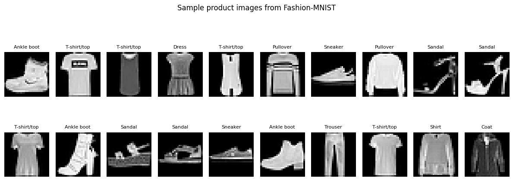
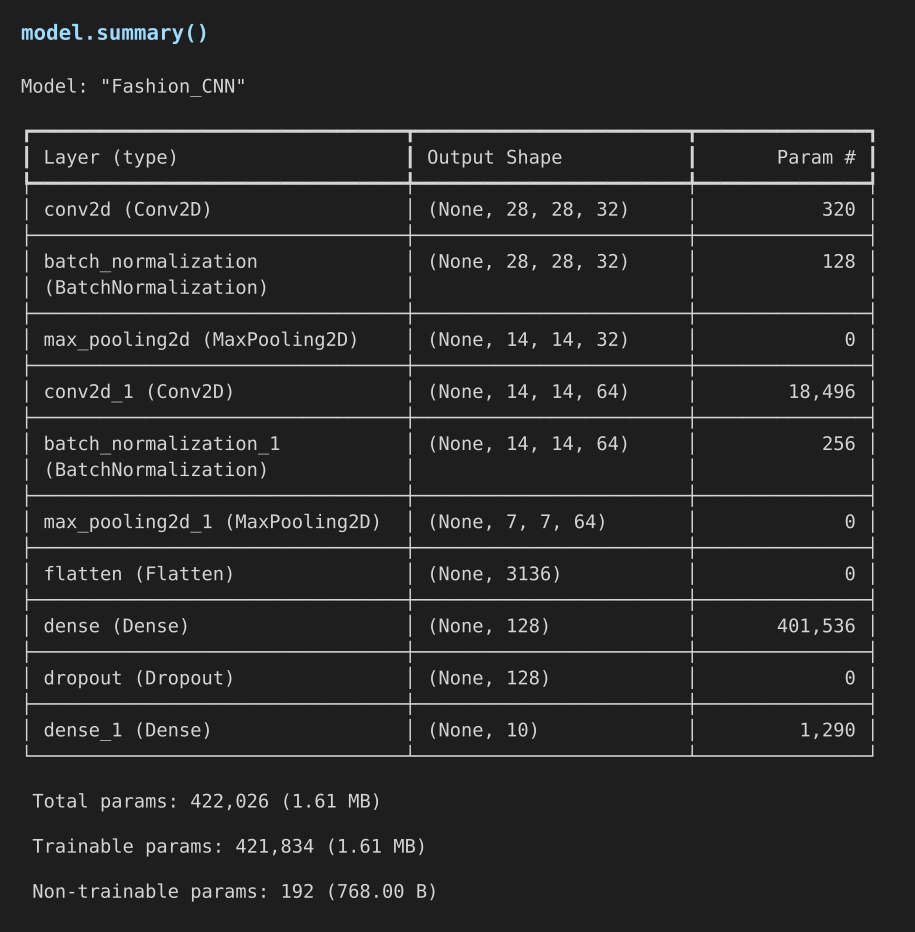
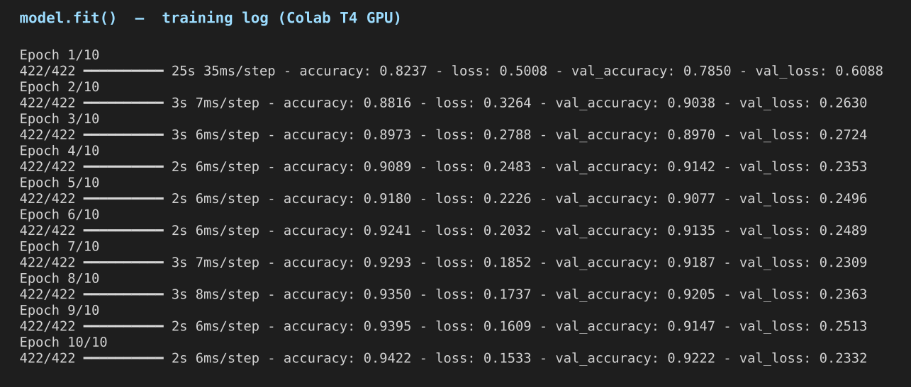
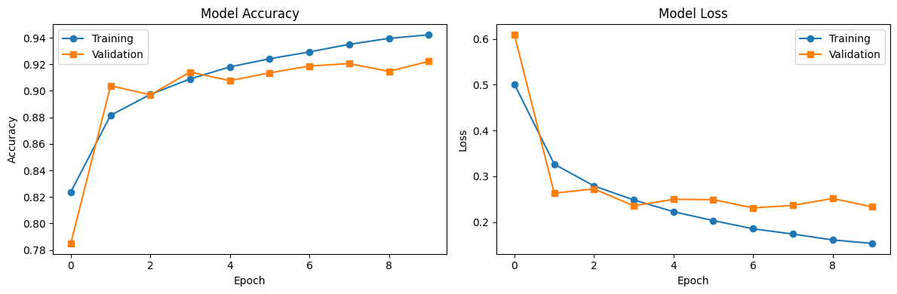
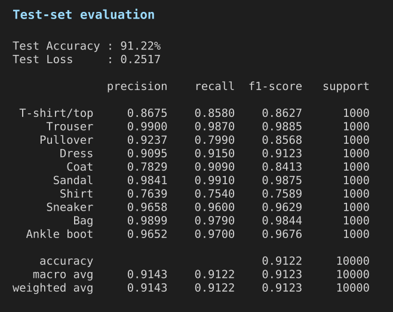
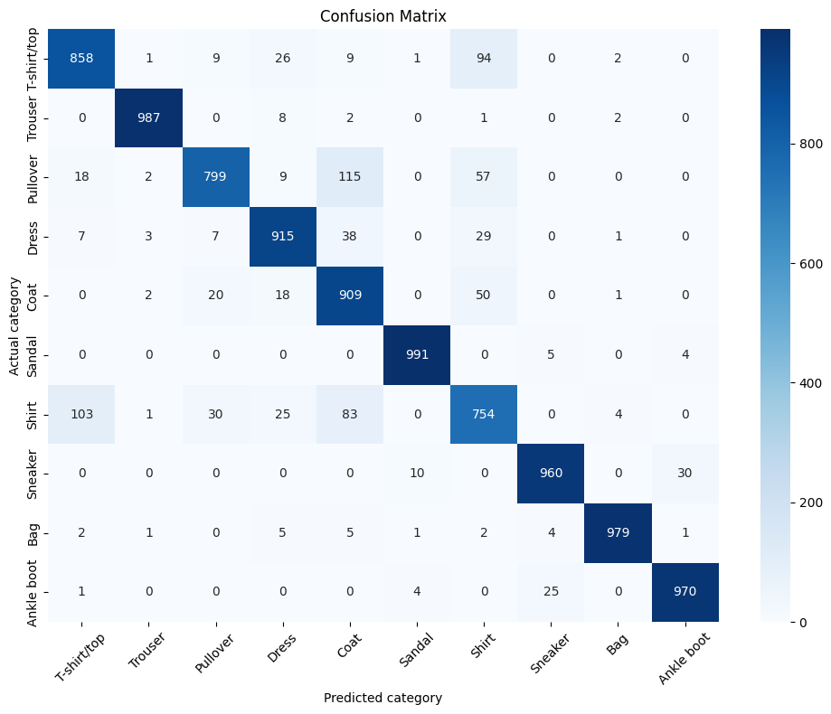
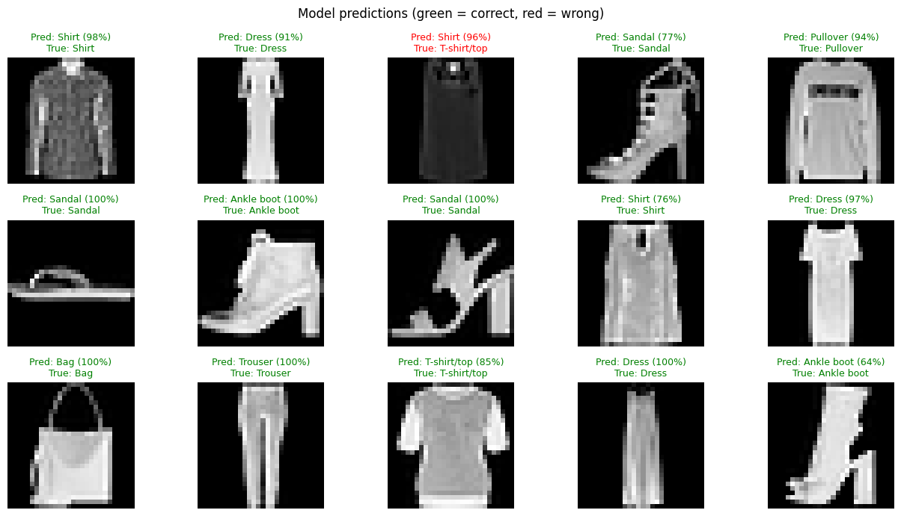
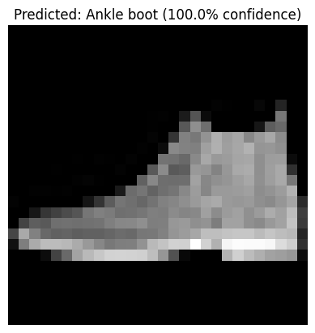

# Automated Fashion Product Classification for E-commerce using CNN

**Deep Learning – Application-Oriented Project**
SRM Institute of Science and Technology · Department of CINTEL · Branch AI-D

| | |
|---|---|
| Student | Bharani Jayanthan K S |
| Register No. | RA2211047010109 |
| Faculty | Dr. Vinoth |

## Problem statement
E-commerce platforms receive thousands of new product photos every day, and categorising them by hand is slow and error-prone. This project builds a **Convolutional Neural Network (CNN)** that automatically classifies a product image into one of 10 fashion categories, so catalogues can be tagged instantly.

## Dataset
**Fashion-MNIST** (Zalando Research), loaded directly with `keras.datasets.fashion_mnist`, so no manual download is needed.
- 70,000 grey-scale images, 28 × 28 pixels (60,000 train / 10,000 test)
- 10 classes: T-shirt/top, Trouser, Pullover, Dress, Coat, Sandal, Shirt, Sneaker, Bag, Ankle boot
- Source: https://github.com/zalandoresearch/fashion-mnist

## Model architecture
```
Input 28×28×1
→ Conv2D(32, 3×3, ReLU) → BatchNorm → MaxPool(2×2)
→ Conv2D(64, 3×3, ReLU) → BatchNorm → MaxPool(2×2)
→ Flatten → Dense(128, ReLU) → Dropout(0.4) → Dense(10, Softmax)
```
Optimiser: Adam · Loss: sparse categorical cross-entropy · Early Stopping (patience 3) · up to 10 epochs, batch size 128

## Syllabus units applied
| Unit | Concepts |
|---|---|
| I | Supervised learning, train/validation/test split, over-fitting, regularization |
| II | Dense layers, ReLU/Softmax, cross-entropy, back-propagation, Adam, Batch Normalization, Dropout, Early Stopping |
| III | Convolution, pooling, CNNs for computer vision |
| V | Deep architectures for computer vision |

## How to run
1. Open `Fashion_Product_Classification_CNN.ipynb` in [Google Colab](https://colab.research.google.com/) (File → Upload notebook, or open it from this repo).
2. Runtime → Change runtime type → **T4 GPU** (optional; CPU also works).
3. Runtime → **Run all**. It takes about 2 minutes on a GPU.

Requirements (pre-installed in Colab): Python 3, TensorFlow 2.x, NumPy, Matplotlib, Seaborn, scikit-learn.

## Results
**Test accuracy: 91.22%** on 10,000 unseen images · test loss 0.2517 · macro F1-score 0.912 · training time under 1 minute on a Colab T4 GPU

| Category | Precision | Recall | F1-score |
|---|---|---|---|
| T-shirt/top | 0.868 | 0.858 | 0.863 |
| Trouser | 0.990 | 0.987 | 0.989 |
| Pullover | 0.924 | 0.799 | 0.857 |
| Dress | 0.910 | 0.915 | 0.912 |
| Coat | 0.783 | 0.909 | 0.841 |
| Sandal | 0.984 | 0.991 | 0.988 |
| Shirt | 0.764 | 0.754 | 0.759 |
| Sneaker | 0.966 | 0.960 | 0.963 |
| Bag | 0.990 | 0.979 | 0.984 |
| Ankle boot | 0.965 | 0.970 | 0.968 |

Most errors are between visually similar upper-body garments (Shirt, T-shirt/top, Pullover, Coat).

## Output screenshots

**Sample dataset images**


**Model summary**


**Training log**


**Training curves**


**Test results**


**Confusion matrix**


**Predictions on unseen products**




## Repository structure
```
├── Fashion_Product_Classification_CNN.ipynb   # complete source code with outputs
├── screenshots/                               # output screenshots
├── README.md
└── docs/                                      # project report (PDF) and presentation (PPT)
```
